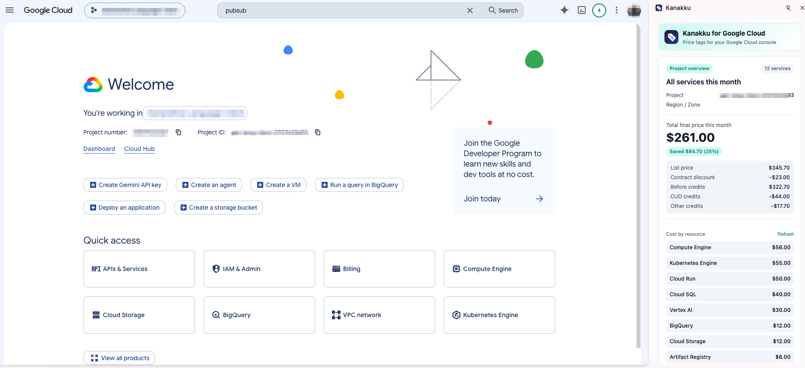
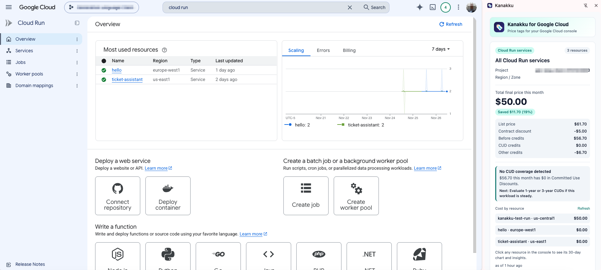

# Kanakku for Google Cloud: price tags for your Google Cloud console

Kanakku for Google Cloud ("Kanakku", Tamil for "accounts", pronounced *KUH-nuk-koo*) is an independent, open source Chrome extension that shows what your Google Cloud resources cost right next to the Google Cloud console.

> **Disclaimer:** Kanakku for Google Cloud is an independent community project and is not affiliated with or endorsed by Google.

## Preview

## Features

- **Resource & Service Cost Waterfall:** Final price this month, List price, Contract discount, CUD credits (`COMMITTED_USAGE_DISCOUNT*`, `FEE_UTILIZATION_OFFSET`), Other credits, and total savings %.
- **30-Day Trend, Burn Rate & Freshness:** Plain-SVG daily cost bar chart with hover tooltips, % change vs. same days last month, month-end pace & daily/hourly burn rate (`estimated`), and data freshness (`as of X hours ago`).
- **Budget Pacing & Action Required Alerts:** Visual budget progress bar (when Monthly spend alert threshold > 0), always-on flat-cost detection, spend spike alerts, credits-masking-spend reminders, and CUD coverage hints.
- **Service List & Project Executive Overview:** Ranked per-resource costs (with region) on service list pages, ranked per-service costs on Console Home (`/home/dashboard`), and one-click **Download CSV**.
- **Standard & Opt-In AI Executive Summary:** Always-on local SRE/FinOps/Leader summary, plus optional Gemini summary when you turn it on and supply your own Gemini API key.
- **Supported Services:** Cloud Run, Compute Engine, Cloud Storage, GKE, BigQuery, Vertex AI, Cloud SQL, Cloud Pub/Sub, Artifact Registry, plus all billed services on Console Home (`/home/dashboard`).

## 10-Minute Setup Guide

### Option A: Installed from Chrome Web Store (Recommended)

> **Prerequisite:** Your organization or project needs the `daily_resource_costs` BigQuery summary table set up **once** by an admin (see [docs/admin-guide.md](docs/admin-guide.md)).

1. **Install the extension** from the Chrome Web Store and pin **Kanakku for Google Cloud** to your Chrome toolbar.
2. **Open Options:** Right-click the Kanakku toolbar icon and choose **Options** (or go to `chrome://extensions` → **Details** → **Extension options**).
3. **Sign in with Google:** Click **Sign in with Google** and grant read-only BigQuery access (`bigquery.readonly`).
4. **Connect your summary table:**
   - **Billing export project ID:** `YOUR_BILLING_PROJECT_ID` (from your admin, or your own billing project)
   - **Dataset name:** `YOUR_DATASET_NAME`
   - **Summary table name:** `daily_resource_costs`
   - **Cache time (minutes):** `60` (default)
   - **Monthly spend alert threshold (0 = off):** Optional monthly budget alert
   - **AI explanations & Gemini API key (optional):** Leave off to use the built-in **Standard Summary** locally, or enable with your own Gemini API key.
5. **Save & verify:** Click **Save settings**, then click **Test connection** — you should see `Connected! Found the summary table in BigQuery.`
6. **Use in Google Cloud Console:** Open any supported service or Console Home (`/home/dashboard?project=...`) and click the Kanakku toolbar icon to open the side panel.

### Option B: Building from Source (Developers)

See [docs/setup-guide.md](docs/setup-guide.md) for creating a local Chrome Extension OAuth client (`oauth.local.json`), building `dist/` with `npm install && npm run build`, and loading it unpacked in `chrome://extensions`.

## What Data It Reads and Why

- **Page URL only:** Kanakku reads only the active `https://console.cloud.google.com/*` tab URL to identify the project, service, or resource. It never reads DOM content or form values.
- **BigQuery read-only:** Queries your own `daily_resource_costs` summary table directly from your browser using `bigquery.readonly`.
- **Optional Gemini API:** Off by default. Only when enabled with your own Gemini API key does Kanakku send the small, visible cost summary to `generativelanguage.googleapis.com`; otherwise it uses the built-in Standard Summary locally.
- See [docs/privacy-policy.md](docs/privacy-policy.md).

## Known Limitations

- Requires the **Detailed usage cost** BigQuery billing export (`gcp_billing_export_resource_v1_*`) and the scheduled summary table (`daily_resource_costs`).
- Cloud Billing exports to BigQuery typically lag by a few hours (up to 24 hours for brand-new resources).
- When a service does not emit resource-level billing rows, Kanakku falls back to project-level service spend labeled `project share`.
- Chrome desktop only (Manifest V3 `chrome.sidePanel` API).

## How to Contribute

Contributions are welcome! Please read [CONTRIBUTING.md](CONTRIBUTING.md) and [SECURITY.md](SECURITY.md) before opening a pull request.

## License

Apache 2.0 — see [LICENSE](LICENSE).
